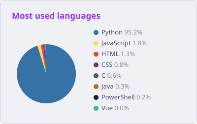
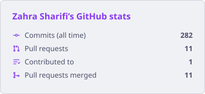
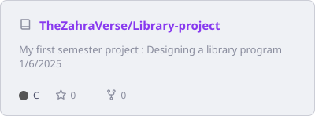
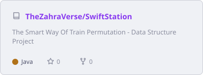
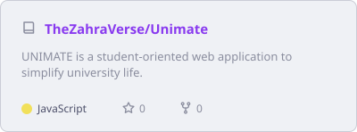
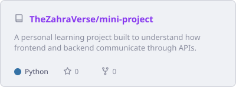
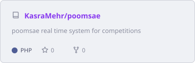
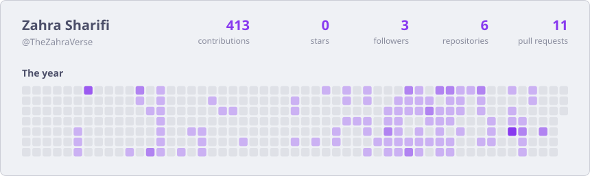

<!-- studio:settings user=TheZahraVerse theme=tokyonight hl=2 border=show follow=on light=catppuccin-latte gap=1 -->

<!-- studio:banner -->

  <picture>
    <source media="(prefers-color-scheme: dark)" srcset="https://raw.githubusercontent.com/TheZahraVerse/TheZahraVerse/main/profile-assets/banner-dark.svg?text=%F0%9D%90%96%F0%9D%90%9E%F0%9D%90%A5%F0%9D%90%9C%F0%9D%90%A8%F0%9D%90%A6%F0%9D%90%9E%20%F0%9D%90%AD%F0%9D%90%A8%20%F0%9D%90%93%F0%9D%90%A1%F0%9D%90%9E%F0%9D%90%99%F0%9D%90%9A%F0%9D%90%A1%F0%9D%90%AB%F0%9D%90%9A%F0%9D%90%95%F0%9D%90%9E%F0%9D%90%AB%F0%9D%90%AC%F0%9D%90%9E&desc=%F0%9F%8C%A0%F0%9D%91%80%F0%9D%91%A6%20%F0%9D%90%B6%F0%9D%91%9C%F0%9D%91%91%F0%9D%91%96%F0%9D%91%9B%F0%9D%91%94%20%F0%9D%91%88%F0%9D%91%9B%F0%9D%91%96%F0%9D%91%A3%F0%9D%91%92%F0%9D%91%9F%F0%9D%91%A0%F0%9D%91%92%F0%9F%8C%8C&shape=waving&paint=theme&animation=fadeIn&section=header&height=200&fontSize=46" />
    
  </picture>

 

<!-- studio:split w=a after=1 -->
<table>
  <tr>
    <td width="100%" valign="top">

Hey there 👋🏼 I'm Zahra Sharifi. 

## 👩🏼‍💻 About Me :

- 🎓 Computer Engineering student
- 💻 Frontend Developer, passionate about building web experiences
- 🌱 Looking forward to exploring AI-powered web applications and intelligent assistants
- 🎨 Exploring UI design and learning to bring creative ideas to life
- ✨ Passionate about discovering smarter, more creative ways to solve problems
- ☕ Fueled by coffee, filled with questions

</td>
  </tr>
</table>

 

<!-- studio:socials -->
<h2 align="center">Stay Connected🔗</h2>

  
  
  

 

<!-- studio:stack -->
<h2 align="center">Tech Stack🔭</h2>

  <b>Programming Languages</b> 
  <picture>
    <source media="(prefers-color-scheme: dark)" srcset="https://raw.githubusercontent.com/TheZahraVerse/TheZahraVerse/main/profile-assets/stack-programming-languages-dark.svg?i=java%2Cpy%2Cc&perline=10" />
    
  </picture>

  <b>Frontend Development</b> 
  <picture>
    <source media="(prefers-color-scheme: dark)" srcset="https://raw.githubusercontent.com/TheZahraVerse/TheZahraVerse/main/profile-assets/stack-frontend-development-dark.svg?i=html%2Ccss%2Cjs%2Creact%2Cvue%2Ctailwind%2Cvite%2Cfigma&perline=10" />
    
  </picture>

  <b>DevOps and cloud</b> 
  <picture>
    <source media="(prefers-color-scheme: dark)" srcset="https://raw.githubusercontent.com/TheZahraVerse/TheZahraVerse/main/profile-assets/stack-devops-and-cloud-dark.svg?i=docker%2Cgithubactions%2Clinux&perline=10" />
    
  </picture>

  <b>Tools</b> 
  <picture>
    <source media="(prefers-color-scheme: dark)" srcset="https://raw.githubusercontent.com/TheZahraVerse/TheZahraVerse/main/profile-assets/stack-tools-dark.svg?i=vscode%2Cgit%2Cgithub%2Cnotion&perline=10" />
    
  </picture>

 

<!-- studio:langs+stats -->

  <picture>
    <source media="(prefers-color-scheme: dark)" srcset="https://raw.githubusercontent.com/TheZahraVerse/TheZahraVerse/main/profile-assets/card-langs-dark.svg?layout=pie&langs_count=8" />
    
  </picture>
  <picture>
    <source media="(prefers-color-scheme: dark)" srcset="https://raw.githubusercontent.com/TheZahraVerse/TheZahraVerse/main/profile-assets/card-stats-dark.svg?show_icons=true&include_all_commits=true&hide_rank=true&hide=stars%2Cissues&show=prs_merged" />
    
  </picture>

 

<!-- studio:repos -->
<h2 align="center">Projects &amp; Contributions💻</h2>

  <a href="https://github.com/TheZahraVerse/Library-project"><picture>
    <source media="(prefers-color-scheme: dark)" srcset="https://raw.githubusercontent.com/TheZahraVerse/TheZahraVerse/main/profile-assets/card-repo-library-project-dark.svg?username=TheZahraVerse&repo=Library-project&show_owner=true" />
    
  </picture></a>
  <a href="https://github.com/TheZahraVerse/SwiftStation"><picture>
    <source media="(prefers-color-scheme: dark)" srcset="https://raw.githubusercontent.com/TheZahraVerse/TheZahraVerse/main/profile-assets/card-repo-swiftstation-dark.svg?username=TheZahraVerse&repo=SwiftStation&show_owner=true" />
    
  </picture></a>
  <a href="https://github.com/TheZahraVerse/Unimate"><picture>
    <source media="(prefers-color-scheme: dark)" srcset="https://raw.githubusercontent.com/TheZahraVerse/TheZahraVerse/main/profile-assets/card-repo-unimate-dark.svg?username=TheZahraVerse&repo=Unimate&show_owner=true" />
    
  </picture></a>
  <a href="https://github.com/TheZahraVerse/mini-project"><picture>
    <source media="(prefers-color-scheme: dark)" srcset="https://raw.githubusercontent.com/TheZahraVerse/TheZahraVerse/main/profile-assets/card-repo-mini-project-dark.svg?username=TheZahraVerse&repo=mini-project&show_owner=true" />
    
  </picture></a>
  <a href="https://github.com/TheZahraVerse/pomsae-operator"><picture>
    <source media="(prefers-color-scheme: dark)" srcset="https://raw.githubusercontent.com/TheZahraVerse/TheZahraVerse/main/profile-assets/card-repo-pomsae-operator-dark.svg?username=TheZahraVerse&repo=pomsae-operator&show_owner=true" />
    
  </picture></a>
  <a href="https://github.com/KasraMehr/poomsae"><picture>
    <source media="(prefers-color-scheme: dark)" srcset="https://raw.githubusercontent.com/TheZahraVerse/TheZahraVerse/main/profile-assets/card-repo-poomsae-dark.svg?username=KasraMehr&repo=poomsae&show_owner=true" />
    
  </picture></a>
  <a href="https://github.com/KasraMehr/property_seeker"><picture>
    <source media="(prefers-color-scheme: dark)" srcset="https://raw.githubusercontent.com/TheZahraVerse/TheZahraVerse/main/profile-assets/card-repo-property-seeker-dark.svg?username=KasraMehr&repo=property_seeker&show_owner=true" />
    
  </picture></a>

 

<!-- studio:metrics plugins=isocalendar -->

  <picture>
    <source media="(prefers-color-scheme: dark)" srcset="https://raw.githubusercontent.com/TheZahraVerse/TheZahraVerse/main/profile-assets/card-overview-dark.svg?plugins=isocalendar" />
    
  </picture>

 

<!-- studio:footer -->

💜 Thanks for stopping by! See you among the stars ✨

